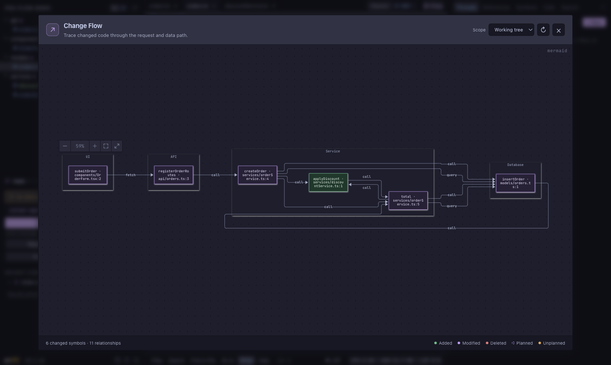

# px0-flow

**Follow a code change through your system, from the screen a user touches to the data it reads or writes.**

px0-flow is a code review workspace built on [px0](https://github.com/px0-ai/px0). It keeps px0's fast, lightweight code navigation and Git review tools, then adds a visual Change Flow view that connects changed symbols across the UI, API, service, and database layers.

Instead of reconstructing a feature from a list of changed files, open the graph, follow the relationships, and jump straight from a node to its diff. Use it to review your own work, trace an agent's edits, or compare a planned code path with what actually landed.

## See Change Flow

This example follows a discount-code change from the UI through the API and service layers to the database. The graph groups changed symbols by layer and labels the connections it inferred. Click the screenshot to open the full-size image.

[](docs/assets/demo-change-flow.png)

### Launch it from any repository

Build px0-flow, then run it against a repository with changes:

```console
$ make build
$ ./px0 /path/to/repository
```

For a one-command workflow, install the global Git alias once from the px0-flow checkout:

```console
$ make git-px0-flow
Installed 'git px0-flow'. Run it inside any repo. Remove it with: git config --global --unset alias.px0-flow
```

After that, run the command from any repository. px0-flow rebuilds itself from this checkout and opens Change Flow on the current repository's changes:

```console
$ cd ~/src/my-app
$ git px0-flow
```

The alias passes through px0 flags, including `-agent claude` and `-port 0`. It also sets `-no-update` so px0's upstream self-updater cannot replace the px0-flow build. Remove the alias with:

```console
git config --global --unset alias.px0-flow
```

Prefer an explicit workspace path? Run `make flow-demo WORKSPACE=/path/to/repository` to build and launch Change Flow in one step.

### Check the graph from a terminal

You can verify the flow API without opening a browser. Start px0-flow from a changed repository in one terminal:

```console
$ cd ~/src/my-app
$ git px0-flow -no-open -port 7778
```

In a second terminal, request the working-tree graph:

```console
$ curl -s 'http://127.0.0.1:7778/api/flow?scope=working'
{
  "scope": "working",
  "nodes": [
    {"id": "src/checkout.ts#applyDiscount", "label": "applyDiscount", "layer": "service", "path": "src/checkout.ts", "line": 42, "status": "modified"}
  ],
  "edges": []
}
```

A smoke test in a throwaway repository with one edited function returned that function with `status: modified`; the test server was shut down afterward.

## Integrate with Codex

px0-flow is a local command-line app. In Codex, launch it by running the existing `git px0-flow` alias in the repository you are working in.

For a one-off launch in the Codex CLI, enter:

```text
!git px0-flow
```

The leading `!` is Codex CLI's shell escape: it tells Codex to execute the rest as a local command under the current approval and sandbox settings. Without `!`, `git px0-flow` is ordinary prompt text and may be interpreted as a request to the model instead of a command. The `!` is Codex syntax; it is not part of the Git alias.

For a reusable skill, save this as `~/.agents/skills/px0-flow/SKILL.md`:

```markdown
---
name: px0-flow
description: Open px0-flow Change Flow for the current Git repository.
---

When invoked, run `git px0-flow` from the current repository. Pass through any px0 flags the user requested. Do not edit repository files. Leave the px0-flow server running so the browser can connect.
```

Invoke it with `$px0-flow` in the Codex CLI or IDE extension, or choose it from `/skills`. Codex slash commands are built in, so a skill does not register a native `/px0-flow` command. See the [Codex skills guide](https://developers.openai.com/codex/skills/) and [slash-command reference](https://developers.openai.com/codex/cli/slash-commands/).

## What the graph shows

Change Flow can map changes from three scopes:

- **Working tree** — staged, unstaged, and untracked changes compared with `HEAD`.
- **Pull request** — the files changed between the PR merge base and its checked-out head.
- **Thread** — files recorded for an agent thread turn, so you can focus on what that session changed.

For each changed file, px0-flow intersects changed diff lines with px0's symbol outline. Changed functions and other symbols become nodes; a file without a matching symbol is shown as a file node. Nodes are grouped into UI, API, service, and database layers and marked by status. Deleted files remain visible in the graph.

Relationships are inferred from references between changed symbols, common `fetch` and Axios URLs, and database symbols. If a language server is already running, px0-flow can add one level of call-hierarchy edges. Text-inferred edges are approximate, so use the graph as a guide into the source and diff. Selecting a node opens the corresponding file at its changed line.

The graph refreshes as Git status changes. Open it from the **Flow** view, **View: Change Flow** in the command palette, or `Cmd/Ctrl+Shift+G`; when a workspace has changes, px0-flow opens the Flow view by default.

### Plan first, compare after

In Thread scope, choose a coding thread and select **Plan flow** to ask its harness for a read-only flow outline before implementation. px0-flow keeps the plan in the thread transcript and overlays it on the actual changes: planned work that landed appears in its real status, unfinished planned nodes remain dashed, and unplanned changes are highlighted. This makes it easier to see where implementation followed or drifted from the intended path.

## More px0 tools

px0-flow inherits px0's code review and navigation features:

- Review GitHub pull requests with scoped merge-base diffs, inline comments, and review actions; inspect local changes in the Git panel and stage, commit, push, or pull.
- Send edits to Claude Code, Gemini CLI, Cursor Agent, Antigravity, OpenCode, Codex, Aider, or Goose, then review the files each turn changed.
- Navigate large repositories with fuzzy file search, workspace search, symbol outlines, and language-server support for code navigation and hover information.
- Inspect Markdown, CSV/TSV tables, and images, with 14 built-in themes and virtual rendering for very large files.
- Use Call Trails to expand who calls a function and what it calls, one level at a time.
- Review unpushed commits one file diff at a time before sending them upstream.

See upstream px0's [performance benchmarks](https://px0.ai/benchmarks) for details on its lightweight design.

## Build from source

Building px0-flow requires Go 1.24 or newer and Node.js or Bun for bundling the web interface.

```bash
git clone https://github.com/valpetaltechlabs/px0-Flow.git
cd px0-Flow
make build
./px0 /path/to/repository
```

Useful development commands:

```bash
make web-check  # Validate frontend modules
make check      # Bundle web assets and run fast checks
make test       # Run the full Go test suite
```

## Roadmap

- Improve relationship accuracy with function-scoped matching and more call-hierarchy data.
- Make larger graphs easier to explore with layer filters, file grouping, and focused neighbourhood views.
- Trace changes across multiple repositories in one workspace.

## License

[MIT License](LICENSE). px0 © Arpit Bhayani. px0-flow modifications © ValPetal Tech Labs.
